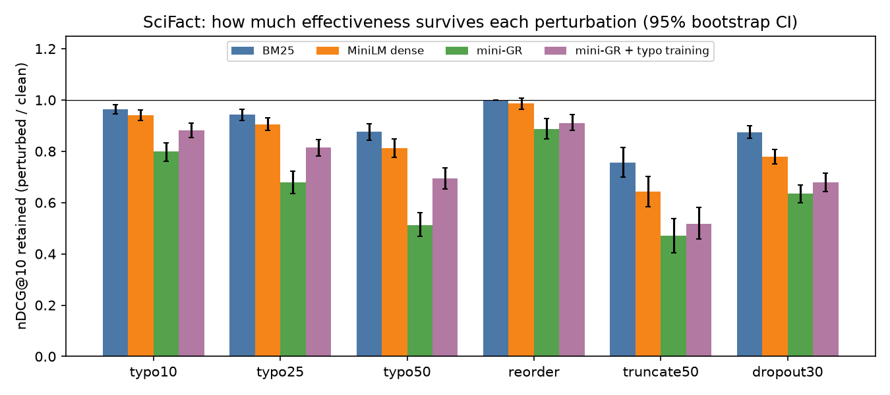
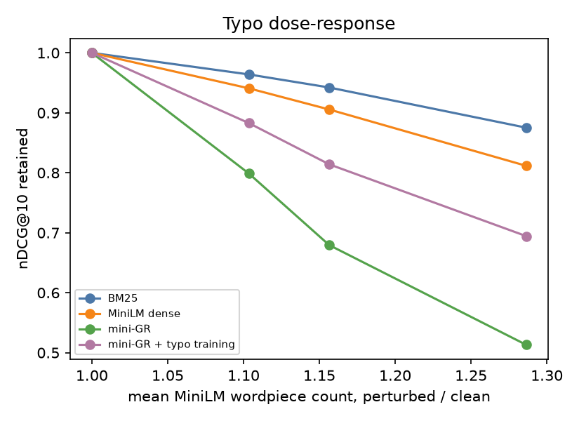
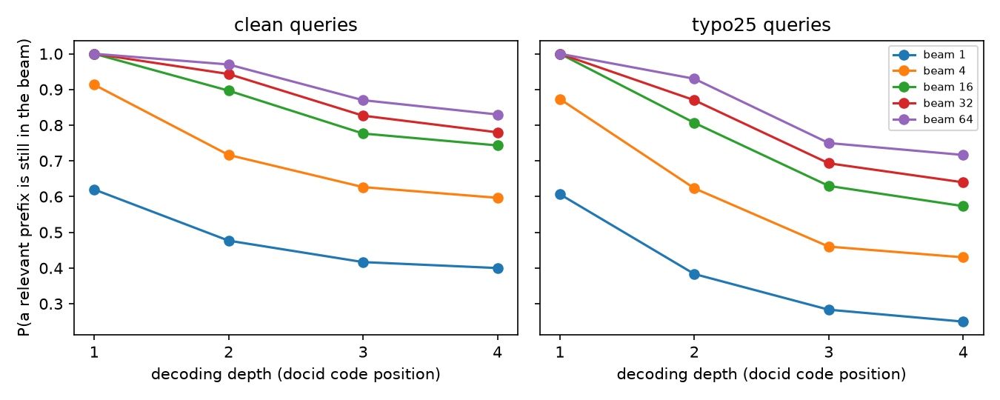

# Query-perturbation robustness of BM25, dense and trie-constrained generative retrieval (SciFact)

> How much retrieval effectiveness survives typos, word reordering, truncation and word dropout when the same queries are
> answered by BM25, a MiniLM dense retriever and a small generative retriever that decodes document identifiers with
> trie-constrained beam search? On BEIR SciFact (5,183 documents, 300 test claims), measured with 5 perturbation seeds and
> bootstrap intervals, the generative model keeps clearly less of its clean nDCG@10 under typos than BM25 or the dense
> model it shares a query encoder with (retention at a 25 % typo rate: 0.68 vs 0.94 and 0.91), and training it on typo-augmented queries recovers
> part of the gap (0.81). All numbers below are written by code into `results/metrics/` and rendered into this file.

**Context.** Mekonnen, Li, Tang, Lupart and de Rijke, *Lost in Decoding? Reproducing and Stress-Testing the Look-Ahead Prior in
Generative Retrieval*, SIGIR 2026 ([doi:10.1145/3805712.3808567](https://doi.org/10.1145/3805712.3808567),
[arXiv:2604.23396](https://arxiv.org/abs/2604.23396)) [1] reproduce Planning Ahead in Generative Retrieval (PAG) and show that
intent-preserving typos can cause "plan collapse" in trie-constrained decoding; they name subword fragmentation a plausible but
untested contributor. I read the abstract and the arXiv HTML text, not the released code. **This repository is not a reproduction of
PAG** and uses neither its checkpoint nor MS MARCO. It is a small, laptop-scale exercise in the same spirit: a controlled
comparison of robustness across retrieval paradigms with calibrated measurement, plus a first look at the subword question.
Independent student project, not affiliated with the authors.

## Question
(1) Do the three retrieval paradigms lose effectiveness at the same rate under intent-preserving query perturbations?
(2) Is the extra loss of the generative model tied to how much a perturbation inflates the number of wordpieces (the
fragmentation hypothesis left open in [1])? (3) Does training on typo-augmented queries close the gap, and how does beam size interact with
early pruning of the right docid prefix?

## Data
BEIR-format SciFact [2] via the `mteb/scifact` mirror on the Hugging Face hub (`make data`, 8 MB, no login; never committed): 5,183 abstracts,
300 test claims with relevance judgements (the BEIR test split), 809 train claims. The dataset is distributed for research use
(check the dataset card for terms). Encoder: `sentence-transformers/all-MiniLM-L6-v2` (about 90 MB, Apache-2.0).

## Method
- **Systems.** BM25 (`rank_bm25`, lower-cased `\w+` tokens, no stemming). Dense: MiniLM cosine over title + abstract.
  **mini-GR** (written here): the query is a frozen MiniLM embedding, a GRU decodes a 4-code docid (a path in a recursive
  16-way k-means tree built on TF-IDF/LSA document vectors, so the identifier space is independent of the encoder), and ranking
  is trie-constrained beam search (default beam 32), so a pruned prefix can never be recovered. Trained for 25 epochs on 51,539
  pseudo-queries (each document's title and sentences plus the SciFact train claims). **mini-GR + typo training** is the same model trained
  on the clean queries plus two typo-corrupted copies.
- **Why this design.** mini-GR and the dense model share the query encoder, so a gap between them is attributable to the identifier and
  decoding layer, not to a different language model.
- **Perturbations** (own code, seeded, `perturb.py`): `typoN` = each word of 4 or more letters gets one character edit (swap, delete, insert,
  keyboard-neighbour substitution) with probability N %, first letter kept; `reorder` = random word shuffle; `truncate50` = first half of the words;
  `dropout30` = drop each word with probability 0.3. 5 seeds per stochastic condition (truncation is deterministic: 1 run).
- **Calibrated measurement.** (a) nDCG@10 with 95 % bootstrap intervals over queries; (b) *retention* = perturbed / clean nDCG@10 so systems with different
  clean levels are comparable, with a joint bootstrap CI; (c) seed-to-seed standard deviation as a noise floor; (d) paired bootstrap on the difference in
  retention between systems; (e) a perturbation-strength table (wordpiece inflation, out-of-vocabulary rate, embedding cosine to the clean query);
  (f) top-10 overlap with the clean ranking, the analogue of the candidate-overlap measure in [1].

## Results
nDCG@10 (clean column: mean and 95 % bootstrap CI over 300 queries; other columns: mean over seeds):
<!-- table:main -->
| system | clean | typo10 | typo25 | typo50 | reorder | truncate50 | dropout30 |
|---|---|---|---|---|---|---|---|
| BM25 | 0.652 [0.605, 0.699] | 0.628 | 0.614 | 0.571 | 0.652 | 0.493 | 0.570 |
| MiniLM dense | 0.648 [0.602, 0.695] | 0.610 | 0.587 | 0.526 | 0.639 | 0.416 | 0.505 |
| mini-GR | 0.556 [0.509, 0.604] | 0.444 | 0.378 | 0.285 | 0.494 | 0.262 | 0.353 |
| mini-GR + typo training | 0.625 [0.576, 0.671] | 0.552 | 0.509 | 0.434 | 0.569 | 0.323 | 0.424 |
<!-- /table:main -->

Retention (perturbed / clean nDCG@10, 95 % bootstrap CI):
<!-- table:retention -->
| system | typo10 | typo25 | typo50 | reorder | truncate50 | dropout30 |
|---|---|---|---|---|---|---|
| BM25 | 0.96 [0.95, 0.98] | 0.94 [0.92, 0.96] | 0.88 [0.84, 0.91] | 1.00 [1.00, 1.00] | 0.76 [0.70, 0.82] | 0.87 [0.85, 0.90] |
| MiniLM dense | 0.94 [0.92, 0.96] | 0.91 [0.88, 0.93] | 0.81 [0.78, 0.85] | 0.99 [0.96, 1.01] | 0.64 [0.58, 0.70] | 0.78 [0.75, 0.81] |
| mini-GR | 0.80 [0.76, 0.83] | 0.68 [0.64, 0.72] | 0.51 [0.47, 0.56] | 0.89 [0.85, 0.93] | 0.47 [0.40, 0.54] | 0.63 [0.60, 0.67] |
| mini-GR + typo training | 0.88 [0.85, 0.91] | 0.81 [0.78, 0.85] | 0.69 [0.65, 0.74] | 0.91 [0.88, 0.94] | 0.52 [0.46, 0.58] | 0.68 [0.64, 0.71] |
<!-- /table:retention -->



Paired bootstrap of the difference in retained nDCG@10 between systems (positive = first system retains more):
<!-- table:paired -->
| difference in retained nDCG@10 | typo10 | typo25 | typo50 | reorder | truncate50 | dropout30 |
|---|---|---|---|---|---|---|
| dense - BM25 | -0.02 [-0.08, +0.04] | -0.04 [-0.09, +0.02] | -0.06 [-0.12, -0.00] | -0.01 [-0.07, +0.04] | -0.11 [-0.18, -0.05] | -0.09 [-0.15, -0.04] |
| mini-GR - dense | -0.14 [-0.22, -0.07] | -0.23 [-0.30, -0.16] | -0.30 [-0.37, -0.23] | -0.10 [-0.19, -0.01] | -0.17 [-0.25, -0.10] | -0.15 [-0.21, -0.08] |
| typo-trained GR - mini-GR | +0.08 [+0.04, +0.13] | +0.13 [+0.09, +0.18] | +0.18 [+0.14, +0.22] | +0.02 [-0.03, +0.08] | +0.05 [-0.01, +0.10] | +0.04 [+0.01, +0.08] |
<!-- /table:paired -->

Top-10 overlap with the clean ranking (higher = more stable ranking):
<!-- table:stability -->
| system | typo10 | typo25 | typo50 | reorder | truncate50 | dropout30 |
|---|---|---|---|---|---|---|
| BM25 | 0.80 | 0.73 | 0.59 | 1.00 | 0.43 | 0.62 |
| MiniLM dense | 0.75 | 0.69 | 0.57 | 0.79 | 0.45 | 0.60 |
| mini-GR | 0.50 | 0.42 | 0.29 | 0.55 | 0.23 | 0.39 |
| mini-GR + typo training | 0.50 | 0.43 | 0.31 | 0.53 | 0.23 | 0.37 |
<!-- /table:stability -->

Seed-to-seed standard deviation of mean nDCG@10 (the noise floor for the table above; 0 for the deterministic truncation):
<!-- table:seed -->
| system | typo10 | typo25 | typo50 | reorder | truncate50 | dropout30 |
|---|---|---|---|---|---|---|
| BM25 | 0.0074 | 0.0145 | 0.0103 | 0.0000 | 0.0000 | 0.0140 |
| MiniLM dense | 0.0058 | 0.0070 | 0.0139 | 0.0033 | 0.0000 | 0.0075 |
| mini-GR | 0.0118 | 0.0085 | 0.0136 | 0.0108 | 0.0000 | 0.0186 |
| mini-GR + typo training | 0.0094 | 0.0121 | 0.0100 | 0.0058 | 0.0000 | 0.0200 |
<!-- /table:seed -->

Perturbation strength actually applied (mean over queries and seeds):
<!-- table:calib -->
| condition | wordpiece ratio | query OOV rate | MiniLM cosine to clean | seeds |
|---|---|---|---|---|
| clean | 1.00 | 0.024 | 1.000 | - |
| typo10 | 1.10 | 0.122 | 0.914 | 5 |
| typo25 | 1.16 | 0.172 | 0.876 | 5 |
| typo50 | 1.29 | 0.292 | 0.789 | 5 |
| reorder | 1.00 | 0.024 | 0.942 | 5 |
| truncate50 | 0.51 | 0.025 | 0.775 | 1 |
| dropout30 | 0.71 | 0.024 | 0.841 | 5 |
<!-- /table:calib -->

Fragmentation check, typo conditions pooled, per query and seed:
<!-- table:dose -->
| system | Spearman rho (wordpiece ratio vs per-query nDCG drop) | n query-perturbations |
|---|---|---|
| BM25 | 0.106 [0.076, 0.140] | 4500 |
| MiniLM dense | 0.115 [0.086, 0.144] | 4500 |
| mini-GR | 0.229 [0.200, 0.256] | 4500 |
| mini-GR + typo training | 0.162 [0.133, 0.191] | 4500 |
<!-- /table:dose -->



Beam size and early pruning of mini-GR (seed 1; prefix survival = share of queries where a prefix of a relevant document is still in the beam):
<!-- table:beam -->
| beam | nDCG@10 clean | nDCG@10 typo25 | prefix survival clean (d1/d2/d3/d4) | prefix survival typo25 |
|---|---|---|---|---|
| 1 | 0.377 | 0.235 | 0.62 / 0.48 / 0.42 / 0.40 | 0.61 / 0.38 / 0.28 / 0.25 |
| 4 | 0.520 | 0.349 | 0.91 / 0.72 / 0.63 / 0.60 | 0.87 / 0.62 / 0.46 / 0.43 |
| 16 | 0.556 | 0.384 | 1.00 / 0.90 / 0.78 / 0.74 | 1.00 / 0.81 / 0.63 / 0.57 |
| 32 | 0.556 | 0.384 | 1.00 / 0.94 / 0.83 / 0.78 | 1.00 / 0.87 / 0.69 / 0.64 |
| 64 | 0.556 | 0.384 | 1.00 / 0.97 / 0.87 / 0.83 | 1.00 / 0.93 / 0.75 / 0.72 |
<!-- /table:beam -->



Setup: <!-- table:env -->
5183 documents, 300 test queries, 51539 GR training pseudo-queries; docid code vocabularies (16, 16, 16, 10); beam 32; seeds (1, 2, 3, 4, 5); torch 2.15.0 on mps (arm64), Python 3.13.7; total run time 526.4 s.
<!-- /table:env -->

## What I learned
- All three systems lose effectiveness under typos, but the generative model loses clearly more: at the 25 % typo rate it retains 0.68 of its clean nDCG@10,
  against 0.94 for BM25 and 0.91 for the dense model; the paired interval for mini-GR minus dense retention excludes zero (see the paired table). BM25 versus dense is not
  separable at that rate (the interval includes zero).
- The ranking itself is also less stable: after a 25 % typo rate the generative model keeps 0.42 of its clean top-10, BM25 0.73 and dense 0.69.
- The fragmentation hypothesis gets only weak, correlational support here. Per-query nDCG drop correlates positively with wordpiece inflation for every system, most for
  the plain mini-GR (Spearman 0.23, interval in the table) and about 0.1 for BM25 and dense. BM25 has no wordpieces, so its correlation shows that more heavily
  corrupted queries are harder for any model; the excess for mini-GR is what could be attributed to fragmentation, and this design cannot separate it from the
  decoder's sensitivity to the embedding shift (typo50 moves the query embedding to cosine 0.79 of the clean one).
- BM25 retains 1.00 under `reorder` and its seed spread is 0 there because BM25 here is a bag of words (a sanity check of the harness, not a result). The dense model is worse than BM25 on truncation and word dropout (paired intervals below zero) but not separable from it for typos at 10 and 25 %.
- mini-GR loses more than the dense model under every perturbation I ran, including reordering (-0.10, interval just below zero), so the gap is not specific to character noise.
- Typo-augmented training helps (retention at typo25 0.81 vs 0.68, paired interval above zero) and also raises clean nDCG@10 in this setting, but does not reach the retention of the dense model, and it does not make the top-10 more stable (overlap 0.43 vs 0.42 at typo25): the model gets better at the right answers without moving its candidate set less.
- Early pruning is visible: with a wider beam the prefix-survival rate rises (clean depth 4: 0.40 at beam 1 to 0.83 at beam 64), and it is lower for typo queries at every beam, but nDCG@10 is identical for beams 16, 32 and 64 (a plateau I did not investigate further).

## Limitations
- mini-GR is a small DSI-style model with a frozen encoder and a 4-level docid tree, trained on pseudo-queries from the same corpus it is tested on. It says nothing quantitative about PAG, T5-based generative retrievers or MS MARCO-scale collections.
- One small collection (SciFact, 300 test claims); intervals reflect query sampling, not training-run variance: each GR model was trained once (seed 0).
- The perturbations are synthetic, rule-based and not validated for intent preservation by humans; typos are only inserted into words of 4 or more letters. No synonym or LLM-paraphrase condition (not run).
- The fragmentation analysis is correlational; a clean test would hold the embedding shift fixed while changing the tokenisation.
- Typo-training increases clean nDCG@10 partly because it doubles-plus the training pairs; I did not run a size-matched control.
- BM25 uses no stemming or stop-word removal; a stemmed variant would likely change its typo retention.

## Reproduce
```bash
make venv && make data && make eval && make figures && make readme
make test
```
Everything above was produced in one run of `scripts/run_eval.py` on an Apple M3 Pro (18 GB, MPS): about 9 minutes in total (details in the setup line).

## References
1. K. Amde Mekonnen, Y. Li, Y. Tang, S. Lupart, M. de Rijke. *Lost in Decoding? Reproducing and Stress-Testing the Look-Ahead Prior in Generative Retrieval.* SIGIR 2026. doi:10.1145/3805712.3808567, arXiv:2604.23396 (abstract and arXiv HTML read).
2. SciFact in the BEIR format, `mteb/scifact` dataset on the Hugging Face hub (files downloaded and inspected): https://huggingface.co/datasets/mteb/scifact
3. `sentence-transformers/all-MiniLM-L6-v2` model (weights downloaded and used): https://huggingface.co/sentence-transformers/all-MiniLM-L6-v2

## Licence
MIT. Dataset and model keep their own licences.
